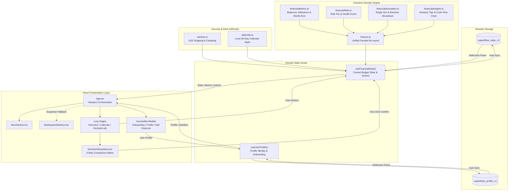

# RupeeWise — 30-Day Financial Decision Simulator

> A deterministic, interactive personal finance decision simulator built for managing a ₹10,000 monthly budget over a dynamic 30-day challenge.

---

## 📌 Project Purpose & Problem Statement

Most personal finance apps suffer from **passive tracking failure**: they record transactions retrospectively, notifying users of an overdraft only after money has already been spent. For young adults and students operating under strict budget constraints (such as ₹10,000/month), a single impulse purchase or unexpected expense can derail savings and leave essential bills unpaid.

**RupeeWise** transforms personal finance into an active **Decision Simulator**. Before spending, users test purchases inside the **Decision Lab** to forecast exact consequences on:
- Nominal liquid cash (**Available Balance**).
- Real discretionary runway (**Spendable Balance** after upcoming essential commitments and savings goals).
- Daily spending discipline (**Safe Daily Allowance**).
- Predictive cash position (**Projected Month-End Forecast**).
- Risk tier (`Low`, `Moderate`, `High`) and multi-factor **Financial Health Score** (0–100).

---

## 🌟 Key User-Facing Features

1. **Cinematic Ambient Hero**: Full-screen introductory hero (approx 100svh) with 3 selectable atmospheres (`01 / FLOW`, `02 / FOCUS`, `03 / CLARITY`), real-time challenge status pill, dynamic time-of-day greeting, and reduced-motion fallback.
2. **Interactive Financial Calendar**: Date-aware calendar view showing monthly grid, challenge boundaries, and daily expense totals. Users can inspect any day or log expenses prefilled to that date (with future-date restriction).
3. **Financial Decision Showdown (Phase 2 Innovation)**: Three-way comparative decision engine inside the Decision Lab. Compare **Current State vs. Option A vs. Option B** across spendable buffer, month-end projection, daily allowance, risk tier, and health score. Features:
   - **Essential vs. Discretionary Nuance**: Never blindly declares the cheaper option the winner when one option fulfills a critical need (e.g. tuition/rent) and remains solvent.
   - **Interactive Dilemma Presets**: One-click test scenarios like *Coursepack vs. Concert*, *Laptop Repair vs. Weekend Trip*, or *Home Grocery vs. Swiggy Streak*.
   - **Direct Confirmation**: Single-click commit action logs exactly one expense to the ledger, updates the active challenge, and dismisses simulation state.
4. **Committed Obligations & Bill Tracking**: Track essential vs. discretionary bills (rent, WiFi, recharge). Marking bills paid logs the transaction exactly once; cancelling subscriptions frees spendable buffer without fabricating cash refunds.
5. **Earmarked Savings Goals**: Emergency fund and goal allocations that shield money from discretionary spending without skewing variable living costs.
6. **Local Profile Management**: Onboard with name, email, and avatar theme. Profile data operates decoupled from the budget state and supports fresh challenge resets.

---

## 🏗️ Architecture & Cohesive Domain Separation

RupeeWise follows a clean, decoupled frontend architecture. Large monolithic modules have been decomposed into dedicated domain calculation modules, pure mathematical utilities, custom hooks, and presentation components:

```text
monthly_budget_tracker/
├── index.html                  # HTML entry with font preconnects & metadata
├── src/
│   ├── main.tsx                # React 19 application root mounting
│   ├── App.tsx                 # Viewport orchestration, layout, modal disclosure
│   ├── index.css               # Tailwind v4 theme tokens & baseline styles
│   ├── types/
│   │   └── finance.ts          # Domain interfaces (FinancialState, ShowdownOptionInput, etc.)
│   ├── hooks/
│   │   ├── index.ts            # Hook barrel exports
│   │   ├── useFinancialState.ts# Domain state hook: financial calculations, persistence, mutations
│   │   └── useUserProfile.ts   # User profile hook: identity, avatars, onboarding lifecycle
│   ├── components/
│   │   ├── HeroSection.tsx     # Full-screen introductory atmosphere & challenge status
│   │   ├── Sidebar.tsx         # Responsive navigation bar with active indicators
│   │   ├── BalanceCard.tsx     # Available balance & visual progress card
│   │   ├── MetricCard.tsx      # Reusable financial metric presentation cards
│   │   ├── SpendingChart.tsx   # Category breakdown pie chart
│   │   ├── CommitmentList.tsx  # Unpaid and paid bill obligations
│   │   ├── SavingsGoalCard.tsx # Savings goal progress and contribution controls
│   │   ├── DecisionSimulator.tsx # Before vs. After single purchase simulator
│   │   ├── DecisionShowdown.tsx  # Three-way comparative decision showdown matrix
│   │   ├── OnboardingModal.tsx # First-time user greeting modal with input validation
│   │   ├── ProfileModal.tsx    # User settings and challenge reset dialog
│   │   └── WorkspaceSkeleton.tsx # Layout-stable Suspense placeholder for lazy pages
│   ├── pages/                  # Lazy-loaded workspace views (React.lazy / Suspense)
│   │   ├── Overview.tsx        # Central financial dashboard & health scores
│   │   ├── CalendarPage.tsx    # Interactive 30-day calendar & day-level logger
│   │   ├── Transactions.tsx    # Transaction ledger, category filters & manual entry
│   │   ├── DecisionLab.tsx     # Decision simulation workspace (Single & Showdown modes)
│   │   ├── SavingsGoals.tsx    # Savings target cards & goal creator
│   │   └── Commitments.tsx     # Bills and recurring commitments manager
│   ├── utils/
│   │   ├── index.ts            # Utility barrel exports
│   │   ├── finance.ts          # Unified facade re-exporting all domain utilities
│   │   ├── financialMetrics.ts # Pure metric arithmetic (available, spendable, allowance, month-end)
│   │   ├── financialRisk.ts    # Multi-factor risk tiers & 0-100 financial health scoring
│   │   ├── financialSimulation.ts # Purchase simulator & 3-way showdown comparison engine
│   │   ├── financialInsights.ts   # Actionable advisory tips, breakdowns & cash flow projection
│   │   ├── dateUtils.ts        # Timezone-safe local calendar arithmetic
│   │   ├── storage.ts          # Defensive localStorage schema parser and fallback
│   │   └── sanitize.ts         # XSS mitigation, amount bounds, string sanitization
│   └── data/
│       └── demoData.ts         # Initial ₹10,000 30-day budget seed state
├── test_scenarios.ts           # Automated test suite (Scenarios A through M)
├── tsconfig.app.json           # Strict TypeScript configuration
└── vite.config.ts              # Vite configuration with vendor chunk splitting
```

### Module Responsibilities

| Module | Scope & Responsibility |
| :--- | :--- |
| `financialMetrics.ts` | Pure calculations for `calcAvailableBalance`, `calcSpendableBalance`, `calcSafeDailyAllowance`, `calcProjectedMonthEnd`, and `calcVariableSpent`. Zero DOM or state dependencies. |
| `financialRisk.ts` | Multi-factor risk tier assignment (`Low`, `Moderate`, `High`) and 4-pillar financial health scoring (`Liquidity`, `Savings`, `Spending Discipline`, `Commitment Coverage`). |
| `financialSimulation.ts` | Purchase projection (`simulatePurchase`) and three-way comparative matrix analysis (`evaluateShowdown`). Never mutates stored records. |
| `financialInsights.ts` | Trend-based financial warnings, category spending distributions, and day-by-day cash flow curve construction. |
| `finance.ts` | Backward-compatible modular facade re-exporting all submodules with zero breakage. |
| `useFinancialState.ts` | Single source of truth for budget mutations. Isolates ledger updates, bill marking, and storage syncing from presentation. |
| `useUserProfile.ts` | Manages identity, avatar themes, and onboarding flags decoupled from financial calculations. |

---

## 🔄 Data Flow Architecture

The application ensures unidirectional data flow where React components display computed derived values rather than executing ad-hoc financial formulas:



---

## 🧮 Core Financial Formulas & Double-Counting Prevention

All financial metrics are computed deterministically in `src/utils/finance.ts`:

1. **Available Balance**:
   $$\text{Available Balance} = \text{Starting Budget} + \sum \text{Income} - \sum \text{Expenses}$$
   Nominal liquid cash currently held.
2. **Spendable Balance**:
   $$\text{Spendable Balance} = \text{Available Balance} - \text{Unpaid Commitments} - \text{Remaining Savings Target}$$
   Represents true discretionary runway. Earmarks upcoming mandatory bills and unmet savings goals so users do not spend money already allocated for commitments.
3. **Safe Daily Allowance**:
   $$\text{Safe Daily Allowance} = \max\left(0, \left\lfloor \frac{\text{Spendable Balance}}{\text{Days Remaining}} \right\rfloor\right)$$
   Smooths discretionary runway evenly across the remaining calendar days.
4. **Projected Month-End Balance**:
   $$\text{Burn Rate} = \frac{\text{Variable Expenses}}{\max(1, \text{Elapsed Days})}$$
   $$\text{Projected Month-End} = \text{Available} - \text{Unpaid Commitments} - (\text{Burn Rate} \times \text{Days Remaining})$$
5. **Double-Counting Prevention**:
   - **Commitments vs. Expenses**: Unpaid commitments reduce *Spendable Balance*, but do **not** reduce *Available Balance*. When a user clicks "Mark Paid", the commitment is marked `paid` and an expense transaction is logged. The obligation moves from "unpaid commitment" to "recorded expense" without double-reducing spendable cash.
   - **Savings Allocation**: Adding money to savings increases `savedAmount` and logs a dedicated `savings` transaction, reducing spendable buffer while keeping target feasibility intact.
   - **Subscription Cancellation**: Cancelling an unpaid subscription marks it `cancelled`, which frees the spendable buffer without fabricating a cash refund into Available Balance.

---

## 📅 Challenge Date Calculation Rules

To prevent timezone inconsistencies (e.g., UTC midnight causing day-shifts in IST), `src/utils/dateUtils.ts` operates strictly on local `YYYY-MM-DD` strings:
- **Challenge Period**: Fixed 30-day duration starting on the user's local date (`periodStart`).
- **Day Number**:
  $$\text{Current Day} = \min(30, \max(1, \text{difference in calendar days} + 1))$$
- **Days Remaining**:
  $$\text{Days Remaining} = \max(0, 30 - \text{Current Day} + 1)$$
- **Status Lifecycle**:
  - `active`: Current date is between `periodStart` and `endDate`.
  - `completed`: Current date is past `endDate` (Day 30, 0 days remaining).
  - `upcoming`: Current date is before `periodStart`.
- **Expense Validation**: Calendar expenses cannot be logged for future calendar dates.

---

## 🔒 Security, Input Validation & Local Storage Resilience

### Sanitization Pipeline (`src/utils/sanitize.ts`)
- **Text Inputs**: Strips HTML tags (`<[^>]*>`), removes non-printable ASCII control characters, collapses excessive whitespace, and caps length at 120 characters.
- **Email Validation**: Strict regex verification (`^[a-z0-9._%+-]+@[a-z0-9.-]+\.[a-z]{2,}$`), lowercase normalization.
- **Financial Amounts**: Clamped to finite positive integer bounds ($\text{min: } 1, \text{max: } 1,000,000$). Non-numeric strings and `NaN` revert to configured fallbacks.
- **Date Verification**: Strict `YYYY-MM-DD` format verification and Gregorian calendar date validation (rejects invalid dates like Feb 31).

### Storage Resilience (`src/utils/storage.ts`)
`localStorage` parsing operates under defensive schemas. If storage contains corrupt JSON, negative budgets, invalid dates, or malicious payloads, the loader falls back to valid state structures (`createNewUserFinancialState()` or `DEMO_STATE`) without crashing.

### Privacy & Authentication Limitations
> **Security Notice**: Profile and financial records are stored purely on the client inside the user's browser `localStorage`.
> - **No Server-Side Authentication**: Entering a name and email creates a local session persona; it does **not** authenticate against an identity provider or database.
> - **No Plaintext Passwords**: RupeeWise does not prompt for or store passwords.
> - **Data Isolation**: Clearing browser data or opening incognito mode creates a fresh local sandbox.

---

## ♿ Accessibility & Keyboard Support

- **ARIA Dialog Semantics**: All modals (`OnboardingModal`, `ProfileModal`, Add Expense, Reset Confirmation) implement `role="dialog"`, `aria-modal="true"`, and semantic `aria-labelledby` headers.
- **Keyboard Dismissal**: Pressing the `Escape` (ESC) key cleanly closes any active modal.
- **Form Associations**: All inputs are programmatically bound to their labels using explicit `id` and `htmlFor` pairings.
- **Accessible Names**: All icon-only buttons (notifications, reset, calendar chevrons, close triggers) carry explicit `aria-label` attributes.
- **Focus Indicators**: Interactive elements feature high-contrast visible focus rings (`focus-visible:ring-2 focus-visible:ring-[#5138EC]`).
- **Reduced Motion**: Respects `prefers-reduced-motion: reduce` by replacing background video loops with lightweight static CSS gradients.

---

## ⚡ Runtime Performance & Bundle Optimization

- **Measured Production Build Footprint** (`npm run build`):
  - Primary Entry JavaScript: **266.36 kB** (gzip: **79.85 kB**).
  - Production Stylesheet: **51.18 kB** (gzip: **8.92 kB**).
  - Decision Lab Route Chunk: **41.58 kB** (gzip: **9.14 kB**).
  - Financial Insights Chunk: **3.02 kB** (gzip: **1.40 kB**).
  - Calendar Page Chunk: **16.67 kB** (gzip: **4.15 kB**).
  - Overview Dashboard Chunk: **13.23 kB** (gzip: **3.55 kB**).
  - Vendor Charts (`recharts`): **383.71 kB** (gzip: **110.72 kB**).
  - Vendor Animations (`framer-motion`): **126.89 kB** (gzip: **41.67 kB**).
  - **Zero Vite chunk size warnings** across all generated assets.
- **Route-Level Code Splitting**: All workspace views (`Overview`, `CalendarPage`, `DecisionLab`, `Transactions`, `SavingsGoals`, `Commitments`) are dynamically imported via `React.lazy` and wrapped in `Suspense`.
- **Zero-Layout-Shift Skeleton**: `WorkspaceSkeleton` preserves page geometry and dimensions during route transitions, guaranteeing 0.00 Cumulative Layout Shift (CLS).
- **Non-Blocking Font Delivery**: Google Fonts preconnected with `display=swap`, removing render-blocking CSS stylesheets from the critical rendering path.

---

## 🛠️ Technology Stack

- **Framework**: React 19 (`react`, `react-dom`)
- **Language**: TypeScript 5.8 (Strict mode enabled)
- **Bundler**: Vite 8 with `@vitejs/plugin-react`
- **Styling**: Tailwind CSS v4 (`@tailwindcss/vite`)
- **Animation**: Framer Motion 14
- **Charts**: Recharts 3
- **Icons**: Lucide React
- **Linter**: Oxlint (fast static analyzer)

---

## 💻 Commands & Development Guide

### Prerequisites
- Node.js 18+ (tested on Node 20+)
- npm or pnpm

### Installation
```bash
npm install
```

### Start Development Server
```bash
npm run dev
```

### Run Automated Scenario Tests
```bash
npm test
```
Runs 13 comprehensive automated test suites in `test_scenarios.ts` verifying:
- **Scenario A**: New User Onboarding (real local date, clean ledger, Day 1).
- **Scenario B**: Dynamic Date Progression (strictly monotonic 30-day timeline).
- **Scenario C**: Calendar Expense Entry (date validation & active challenge boundary).
- **Scenario D**: Connected Totals Across Workspace (seamless ledger propagation).
- **Scenario E**: Profile & Financial State Separation (independent lifecycle).
- **Scenario F**: Persistence & Reload (defensive restoration without mutations).
- **Scenario G**: Start New 30-Day Challenge (fresh initialization).
- **Scenario H**: Decision Lab & Purchase Simulation Regression.
- **Scenario I**: Security & Input Sanitization (XSS mitigation & boundary clamps).
- **Scenario J**: Storage Schema Resilience (recovery from corrupted payloads).
- **Scenario K**: Commitment Cancellation Boundary (frees buffer without fake refunds).
- **Scenario L**: Financial Decision Showdown (3-way comparative matrix, essential priority preservation, state unmutated).
- **Scenario M**: Showdown Option Confirmation (single expense ledger commit & input sanitization).

### Lint Codebase
```bash
npm run lint
```
Runs `oxlint` across all TypeScript and TSX files with **0 warnings and 0 errors**.

### Build for Production
```bash
npm run build
```
Executes TypeScript type check (`tsc -b`) followed by production minification and chunk generation via Vite (`vite build`). Emits output to `dist/`.

---

## 🚀 Deployment Instructions

RupeeWise is a pure, static Single Page Application (SPA). It requires zero backend infrastructure and can be deployed directly to any static host:

### Vercel / Netlify
1. Connect the GitHub repository `BLU-874/Rupee-Wise`.
2. Build command: `npm run build`
3. Output directory: `dist`

### GitHub Pages / Cloudflare Pages
- Ensure all static assets in `dist/` are served with root routing fallback (`index.html`).

---

## ⚠️ Current Limitations & Testing Notes

1. **Frontend-Only Persistence**: Data is scoped to the user's specific browser and device via `localStorage`. Syncing data across devices would require an external cloud database.
2. **Deterministic Simulation vs. Live Banking**: RupeeWise is an educational decision simulator for ₹10,000 monthly budgets; it does not connect to live banking aggregator APIs (such as Plaid or Account Aggregator).
3. **Calendar Bounds**: Financial tracking is scoped to a 30-day challenge window. Past challenge periods can be archived and restarted via the "Start New 30-Day Challenge" action in settings.
